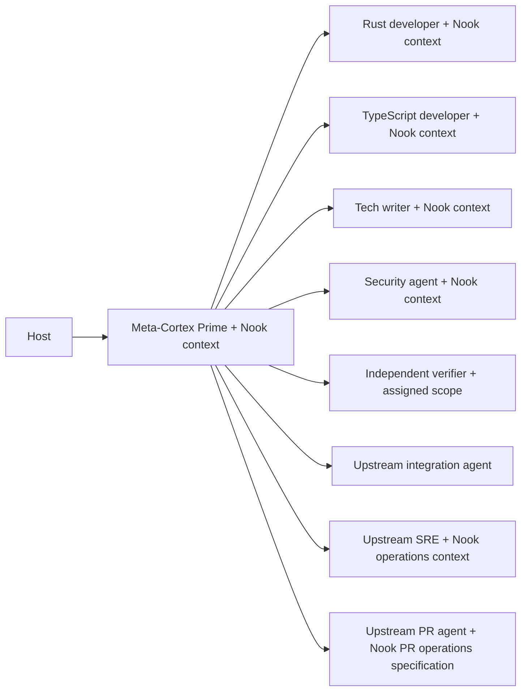
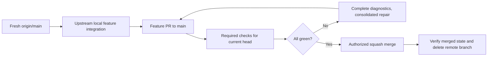

# Nook Delivery Model

## Coordination

The active host launches Meta-Cortex Prime with Nook project context. Prime
directly selects specialists and independent verifiers from upstream catalogs
with Nook project scope. Prime owns the feature and its delivery outcome.

**Prohibited:** start an AI Prime, a Web Prime, and an SRE Prime for one feature.

**Preferred:** Prime sequences bounded assignments and evaluates the specialists'
returned evidence. Nook requirements stay in project documents.

## Delivery

Follow the [feature-delivery contract](dev-delivery.md) for exact Nook stages.
For authorized full delivery, Prime starts a feature from freshly fetched main.
Workers operate in assigned scopes. The upstream integration agent merges their
branches into the feature branch and validates the combined result. PR Lifecycle
publishes only the canonical feature branch under Prime's authority.

**Prohibited:** report a pushed branch or green subset of checks as full delivery.

**Preferred:** report merged-state and cleanup evidence, or the explicit
intermediate result requested by the user. Migration work reaches the PR check
stage unless the user explicitly asks to stop earlier.
