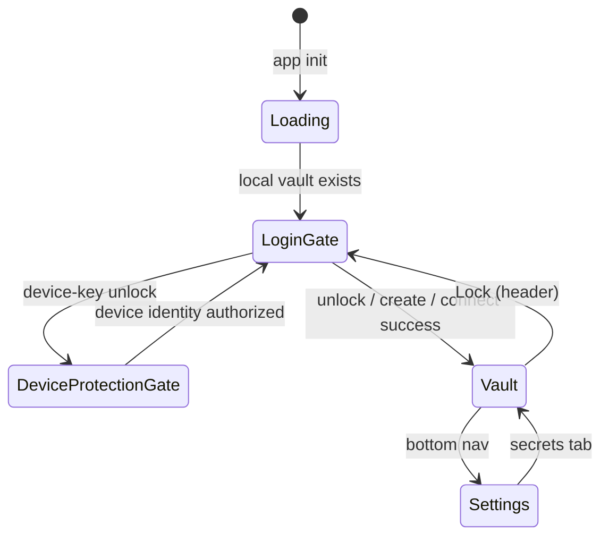

# Auth Providers, Sync, and Login UX

## Overview

How Nook persists **replication-provider** credentials, the **login gate**, and
how provider transports relate independently to identities and vaults.

> **Canonical model:**
> [identity-vault-architecture.md](identity-vault-architecture.md),
> [unified-vault.md](unified-vault.md), and
> [vault-session-and-lock.md](vault-session-and-lock.md).
> Providers are neutral
> **replication targets** mounted independently by identity control logs and
> vault event logs; they are not identities, vaults, or unlock factors.
> Provider **event-log sync** mechanics live in
> [vault-event-log.md](../../../nook-event-log/.cortex/docs/architecture/vault-event-log.md); this doc owns credentials, sealing,
> shared provider targets, authorized accounts, login UX, and OAuth origin
> constraints.

**Related:** [Application architecture](../../../../.cortex/docs/architecture/system.md) §4,
[password-manager.md](../../../../.cortex/docs/spec/password-manager.md) §2A,
[secret-store-identity.md](../../../nook-core/.cortex/docs/architecture/secret-store-identity.md).

---

## 1. Goals

- **Login when locked:** Primary app is the secret vault after unlock; **Lock**
  clears the session and returns to the login gate.
- **Remember sync credentials:** GitHub PAT and provider labels persist in
  IndexedDB — no repeated token prompts.
- **Identity mounts:** Providers are mounted on an identity. One mount
  replicates the identity control log and every vault the identity owns.
  An identity may mount providers before any vault exists.
- **Separation of concerns:** Provider tokens are storage convenience. Vault keys
  remain vault authorization material; provider credentials are sealed locally
  to an installation-specific device key and never prove identity membership.

---

## 2. IndexedDB layout (`nook_auth`)

- **Database**
  - **Value:** `nook_auth`
- **Object store**
  - **Value:** `auth`
- **Key**
  - **Value:** `providers:{app_id}` — one snapshot per local app key
- **Value**
  - **Value:** `{ providers: StorageProvider[], activeVaultStoreId }`

The persisted object is a structured-clone JS object (not a JSON string) in the
tagged shape the Rust types serialize. Rust owns the contract: semantic enums
are used in memory and exported through Tsify/`$app-wasm`, and
`AuthProvidersSnapshotData::from_storage` decodes the stored value. Nothing
stored yet is an empty snapshot; any other shape is rejected rather than
guessed at. There is no singleton record, rollback projection, or schema
marker.

The web layer **re-exports** the semantic types. It does **not** hand-author
mirror interfaces.

A future incompatible persisted shape must ship an explicit, documented
forward migration in the same change. A domain-type refactor alone never
authorizes a wire format change.

### Rows and vaults

- **Remote rows** (`github`, `oauth-file`, `local-folder`) are identity mounts:
  each replicates the identity control log and every vault the identity owns,
  each in its own namespace. Their `storeId` is `unscoped`.
- **Browser rows** (`local`) hold one vault in this browser's own store and are
  scoped to that vault's `storeId`.

### Wire fields (`StorageProvider`, camelCase)

- **`id`, `type`, `label`, `createdAt`**
  - **Notes:** `type`: `local` \| `github` \| `oauth-file` \| `local-folder`
- **`githubPat`, `githubRepo`**
  - **Notes:** GitHub only — PAT sealed at rest
- **`oauthFile`**
  - **Notes:** Drive/iCloud block — see below
- **`localFolder`**
  - **Notes:** File System Access directory handle metadata (`directoryName`, `handleId`)
- **`storeId`**
  - **Notes:** The vault a browser row holds (`store_{token}`); `unscoped` for
    identity mounts. See [secret-store-identity.md](../../../nook-core/.cortex/docs/architecture/secret-store-identity.md)
- **`syncCheckpoint`**
  - **Notes:** Sync bookkeeping

### Wire fields (`oauthFile`)

- **`preset`**
  - **Notes:** `google-drive` \| `icloud`
- **`accessToken`, `refreshToken`**
  - **Notes:** Sealed at rest
- **`expiresAt`, `fileId`, `fileName`, `accountEmail`**
  - **Notes:** Non-secret metadata; `fileName` is the internal event-log
    backup name, never a Drive folder name
- **`folderId`**
  - **Notes:** The account's Google Drive Nook root; unset until the root is
    created or connected
- **`iCloudShareTarget`**
  - **Notes:** iCloud share target; credential-free CloudKit routing, unbound
    until the share is created or accepted

### Ownership

**Persistence + credential crypto live in Rust/WASM.** Snapshot shaping and
sealing are unit-tested in core; IndexedDB I/O and the load pipeline live in
wasm; the web shim is adapters + i18n only.

**Core domain and policy**

- **Snapshot model + pure transforms (`from_storage`, `ensure_local_row`, `find_duplicate_sync_provider`)**
  - **Home:** `nook-app/nook-platform/nook-core/src/sync/sync_provider_store/`
- **Provider-save policy**
  - **Home:** `nook-app/nook-platform/nook-core/src/sync/sync_provider_store/save.rs`
- **Seal/open credential fields with device identity**
  - **Home:** `nook-app/nook-platform/nook-core/src/sync/sync_provider_credentials.rs`
- **Authorized-account list, invite, and joiner rules**
  - **Home:** `nook-app/nook-platform/nook-core/src/sync/authorized_accounts.rs`

**WASM storage and manager APIs**

- **`nook_auth` IndexedDB I/O (rexie) and load pipeline**
  - **Home:** `nook-app/nook-platform/nook-wasm/src/storage/auth_providers.rs`
- **Manager APIs (`load_auth_providers_snapshot`, `load_auth_providers_with_local_row`, `save_auth_providers_snapshot`)**
  - **Home:** `NookVaultManager` methods in `nook-app/nook-platform/nook-wasm/src/vault_api.rs`
- **Delete the auth-provider database with `delete_auth_providers_db`**
  - **Home:** WASM binding + thin TypeScript wrapper
- **Find duplicate sync providers with `find_duplicate_sync_provider`**
  - **Home:** WASM binding + thin TypeScript wrapper
- **Ensure the local provider row with `ensure_local_provider_row`**
  - **Home:** WASM binding + thin TypeScript wrapper
- **Seal providers with `seal_auth_providers_for_device_public_key`**
  - **Home:** WASM binding + thin TypeScript wrapper
- **Create or connect the Drive Nook root and manage authorized accounts**
  - **Home:** `nook-app/nook-platform/nook-wasm/src/public_api/authorized_accounts.rs`,
    wrapped by [`vault/authorized-accounts.ts`](../../../../nook-web/nook-web-shared/src/vault-app/lib/vault/authorized-accounts.ts)
- **List and classify the vaults a provider holds**
  - **Home:** `nook-app/nook-platform/nook-core/src/sync/provider_vault_listing.rs`,
    exported by `nook-app/nook-platform/nook-wasm/src/public_api/provider_vault_listing.rs`
    and routed by [`vault/provider-vaults.ts`](../../../../nook-web/nook-web-shared/src/vault-app/lib/vault/provider-vaults.ts)

**Enrollment and web presentation**

- **Enrollment typestates (`TypedEnrollmentProvider`, personal vs shared)**
  - **Home:** `nook-app/nook-platform/nook-auth2/src/auth/enrollment.rs` (re-exported via `nook-core`)
- **Type re-exports, i18n presentation, wasm wrappers**
  - **Home:** [`auth/providers.ts`](../../../../nook-web/nook-web-shared/src/vault-app/lib/auth/providers.ts)
- **Browser persistence and Svelte state**
  - **Home:** `vault/providers.svelte.ts` under `nook-web-shared`

The provider-save policy owns:

- provider construction;
- duplicate handling;
- vault scoping;
- local-provider row seeding; and
- OAuth configuration merging.

TypeScript owns browser integration:

- supplying generated IDs and timestamps;
- mapping typed failures to translated messages; and
- persisting the resulting snapshot.

- **Credential storage:** Seal secret fields at rest with the device key.
  - Secret fields are `githubPat`, `oauthFile.accessToken`, and
    `oauthFile.refreshToken`.
  - Seal them inside `save_auth_providers` / `seal_provider_credentials` and
    unseal them inside the `load_auth_providers` pipeline.
  - Keep non-secret labels, repositories, and timestamps plaintext.
  - Keep crypto out of TypeScript. See [architecture/packages.md](../../../../.cortex/docs/architecture/packages.md).
- **Current storage mapping:** Existing code names the device key a “device
  identity.” Do not mint another key for provider storage.
  - Reuse this browser's **age X25519 device key**: `device_id` /
    `device_identity_wrapped` in the `nook_db` `vault` store.
  - This is the same identity that unwraps `auth:` envelopes.
  - Authorize it first with the saved passkey's WebAuthn PRF result, or the local
    PIN fallback on PRF-missing platforms.
  - Seal to the device's public key with age self-recipient
    `DeviceIdentity::seal_utf8`.
  - Unseal with the in-memory device secret through
    `DeviceIdentity::open_utf8`.
  - Treat `BEGIN AGE ENCRYPTED FILE` armored values as sealed ciphertext,
    distinct from plaintext credential fields.
- **Extension pairing:** `seal_auth_providers_for_device_public_key` can seal a
  snapshot for another device's public key without writing IndexedDB.
  - Use it when staging credentials for the browser extension.
- **Plaintext rows:** Reject stored **plaintext** provider rows instead of
  loading them.
  - This fail-closed boundary prevents an unsealed credential from remaining
    usable or appearing to be trusted encrypted state.
  - Require users to re-enter the credential so the normal save path persists
    it sealed.
- **Provider switch:** Changing the active saved provider calls
  `reset_vault_session` in WASM and clears login password-entry preview state.
  - Backup-password lists must reflect the remote vault for that provider, never
    a previous provider's in-memory session.

### Google Drive Nook root

Every Google Drive provider is shared. Each Google account holds one
app-owned Nook root folder in My Drive, always named `Nook`
(`NOOK_PROVIDER_ROOT_NAME` in `nook-core`). The identity log and every vault
sync in their own namespace subfolder of that root, independently of vault
replication or membership. Writes remain limited to app-created files below
the root.

- **Scopes:** Sign-in and silent refresh request only the non-sensitive
  `drive.file` scope. It opens, creates, and shares the Nook root and
  reads and writes the event files this app created for the account.
- **Cross-account reads:** Drive authorizes `drive.file` per user, so an
  account cannot read event files another account created. The restricted
  `drive.readonly` scope is requested incrementally, from the user's click,
  only when it is needed: a joiner accepting an onboarding link, and the
  owner authorizing another account. The owner's provider keeps the token
  that grant returns.
- **Earlier grants:** A new provider sign-in sends
  `include_granted_scopes: false`. Otherwise an account that once granted
  `drive.readonly` folds that restricted grant back into the consent and
  sees the unverified-app warning again. Silent refresh and the shared
  requests send `true`, so a `drive.file` refresh still covers
  `drive.readonly` once the account granted it, without another consent
  screen.
- **Verification:** Until Google verifies Nook, consenting to
  `drive.readonly` shows the "Google hasn't verified this app" warning. The
  single-account path never shows it.

- **Target:** The row persists the root's stable Drive ID in `folderId`.
  Its connect reference is `shared:{folderId}`.
- **Setup:** The wizard has no folder-name field. Setup step 2 connects the
  root with `connect_google_drive_vault_folder`. It looks up the account's
  owned, untrashed My Drive root folders named `Nook`. With `drive.file`
  alone, Drive reports only folders Nook created.
  - No match creates the root. A new root is shared with no other account.
  - One match reuses that root. Sync keeps its encrypted events: event
    writes add content-addressed files only when absent, and the setup wizard
    tells the user it found the existing root.
  - Several matches exist only when the user duplicated the root by hand.
    They fail with `GoogleDriveVaultFolderAmbiguous` rather than guessing,
    and the translated error shows in the open step. Rust
    `DriveVaultFolderLookup` owns this decision.
  - Folders with any other name, such as the per-connect `nook-events`
    folders of earlier builds, are ignored. Nothing migrates them.
- **Incomplete rows:** A signed-in Drive provider without a folder is not
  connectable. Its staged connection reports `Incomplete`, and connect
  arguments for a saved row fail with `SharedStorageTargetRequired`.
- **Credentials:** Each authorized account saves a separate OAuth token for
  its own Google account. Tokens never move between accounts.

**Prohibited:** keep a Drive provider's events in the hidden `appDataFolder`
under a `drive.appdata` token because no other account needs them yet.

**Required:** create or connect the Nook root before the provider syncs.
The root's Drive permissions decide which accounts can reach it.

### What the provider already holds

After sign-in, step 2 shows what the account's Nook root holds before
anything is written. `list_google_drive_vaults` looks the root up without
creating it. Rust lists its vault namespaces from Drive metadata, as
[the vault event log](../../../nook-event-log/.cortex/docs/architecture/vault-event-log.md#provider-vault-listing)
describes. No vault is downloaded or decrypted. A vault this browser
registered is named from its vault registry; every other vault's name is
encrypted under its own key, so its row shows the short id instead.

Rust `ProviderVaultListingRequest` decides, for each listed vault, how this
device can open it (`ProviderVaultAccess`) and what the user may do
(`ProviderVaultAction`, recommended action first). The row shows the access
and one line that says what it means.

- **Syncs:** the identity in use holds the vault. It syncs through the
  identity mount; the row offers no action.
- **Other identity here:** another identity on this browser holds the vault
  and its app key here was granted it. It opens from that identity; the row
  offers no action.
- **Granted:** a member approved this app's access request, so its key opens
  the vault.
- **Backup password:** the vault's event log keeps a password envelope, so its
  backup password opens it.
- **Requested:** this app asked for access; a member approves it when its
  device syncs the vault. The row offers no action.
- **Unchecked:** no identity is in use on this browser, as on the login
  screen after browser data was cleared. Nothing was checked, and the user's
  passkey or backup password may still open it, so recovery stays offered.
- **Locked:** nothing on this device opens it. The row says so and offers
  **Request access**.

A vault that opens (granted or by backup password) offers actions by what the
open vault holds:

- **Empty open vault:** no items and no other app. **Use this vault instead**
  comes first: after an explicit confirmation the chosen vault is imported as
  a separate vault, and once it is open the empty vault is deleted from the
  identity everywhere. **Import as a separate vault** is the alternative.
- **Open vault with records:** **Merge into my vault** comes first. After an
  explicit confirmation, and the backup password when that is how it opens,
  Rust reads the vault's events, opens its keys, decrypts its live records,
  and commits them through the open vault's import. Identical logins are
  matched and different passwords stay separate items. The source vault stays
  in the folder unchanged. **Import as a separate vault** is the alternative.
- **No open vault (login screen):** only **Import as a separate vault**, the
  recovery that tries the passkey or backup password.

Around the list:

- **Request access:** writes a self-signed `join-requested` event, carrying
  this app's public keys only, into the vault's subfolder on top of its
  current heads and key epoch. A member's Devices page lists the open vault's
  requests with **Approve** and **Deny**. Approval wraps the vault keys to the
  requesting app; that app then lists the vault as granted.
- **Connect & sync:** stays below the list and says what it does: it saves
  the provider and syncs this identity's vaults into the Nook folder, each in
  its own subfolder. The listed vaults stay as they are unless the user
  chooses an action. It is the step's only primary button; every vault row's
  actions are secondary, so a row never competes with it.
- **Recovery picker:** a provider with several vaults shows the same access
  for every transport and offers recovery only for a vault this device can
  open.

**Prohibited:** union another vault's events into the open vault, or offer an
action that needs keys this device does not hold.

**Required:** merge decrypted records through the import pipeline, import a
vault separately, or ask a member for access; only an empty vault may give
way, after the user confirms.

Future work, not implemented:

- **Request access via join request:** a vault this device cannot open could
  ask its owner for access instead of failing.
- **Copy items into another vault:** a separate explicit action, never sync
  behavior.

### iCloud share target

Every iCloud provider is shared. It syncs under one CloudKit share. Setup
either creates a custom record zone with a shareable root record in the
owner's private database or accepts an existing share.

- **Target:** `iCloudShareTarget` stores an `icloud-share-v1:` reference with
  the routing role, zone name, zone owner record name, root record name, and
  short GUID.
- **Routing:** The owner reaches the zone through its private database. Each
  participant reaches the same hierarchy through its shared database after
  accepting the share. Every event record is a child of the share root.
- **Incomplete rows:** A signed-in iCloud provider without a share target is
  not connectable, as for Drive.
- **Credentials:** The target never contains the owner's CloudKit web-auth
  token. Each account signs into Apple and accepts the share with its own
  account before sync.
- **Setup:** The wizard has no name field; the share is titled `Nook`, like
  every account's root. Creating a share still adds a new custom zone on
  each owner setup.
- **Not yet one root per account:** Finding an existing Nook zone needs a
  CloudKit zone and share lookup that cannot be verified without Apple
  sign-in, so it remains future work. The same per-namespace layout already
  keeps vaults apart inside one share.

### Authorized accounts

The provider's own sharing state is the authorized-account list. Nook keeps no
second copy of it in `nook_auth`, the identity log, or a vault log.

- **Google Drive:** The list contains the Nook root's individual `user`
  permissions. Domain, group, link, and deleted permissions name no account a
  device can use, so the list omits them.
- **iCloud:** The list contains the share participants that CloudKit names by
  email. Accepted participants are active. `INVITED` and `PENDING`
  participants are shown as invited.
- **Known limitation:** Sharing stays at the root. An authorized account can
  see the encrypted files and listing metadata of every vault in the root,
  not only the vaults it was invited to use. It still cannot decrypt a vault
  without that vault's key. Per-vault sharing of namespace subfolders is
  follow-up work.

Rust `AuthorizedAccountList` owns the account rules:

- It orders the owner first, then by email, and removes case-insensitive
  duplicates.
- An addition already on the list fails with `AuthorizedAccountExists`.
- Removing the owner fails with `AuthorizedAccountOwner`.
- An invite names an account on the list. Others fail with
  `AuthorizedAccountMissing`. A reader fails with `AuthorizedAccountReadOnly`,
  because a device syncs by writing events.
- `JoinerAccountCheck` requires the joining device's signed-in account to match
  the invited account case-insensitively. A different account fails with
  `JoinerAccountMismatch`.
- `AuthorizedAccountEmail` validates the address again when it is deserialized
  at the web boundary.

Each provider manages its list through its own sharing API:

- **Drive management:** WASM `list_google_drive_authorized_accounts` reads the
  folder permissions. `add_google_drive_authorized_account` calls
  `permissions.create` with the writer role, and
  `remove_google_drive_authorized_account` calls `permissions.delete`. Each
  change is checked against the current list in Rust and returns the
  refreshed list.
- **iCloud management:** TypeScript reads participants with CloudKit JS
  `fetchRecords`: the root record, then its share record. Rust
  `icloud_authorized_accounts` projects them into the list. CloudKit JS cannot
  invite an account by email, so adding or removing a participant opens
  Apple's sharing sheet (`shareWithUI`).
- **Presentation:** The setup wizard has no storage-mode toggle. After step 2
  creates or connects the target, it shows the Authorized accounts panel.
  **Identity → Sync** shows an Authorized accounts toggle for each Drive and
  iCloud provider. **Add device** picks one account with write access from the
  same panel.

**Prohibited:** grant Drive access to an email typed into the device-invite
form while issuing the code.

**Required:** authorize the account in the Authorized accounts panel first.
The invite then names that account from the provider's list.

### Shared-provider onboarding

This section documents the identity enrollment wire. A code invites an
installation into an identity through one mount. Identity approval then grants
every owned vault, as
[identity-vault-architecture.md](identity-vault-architecture.md#join-an-installation-to-an-identity)
describes.

The same credential-free provider-target rule applies to both identity-control
and vault event-log replication. The payload names `identity` instead of a
vault. Earlier vault-named codes fail closed as invalid codes.

**Provider target handoff**

- Google Drive and iCloud device invites are always `SharedProviderGrant`
  payloads, whatever the vault's `replication_type`.
- The payload carries the shared target, either the Drive `folderId` or the
  `icloud-share-v1:` reference. It also carries `joiner_identity`: the
  authorized account picked from the provider's list.
- Issuing an invite grants no access. The named account must already be on
  the list with write access.
- Codes never carry the owner's OAuth access token, refresh token, or CloudKit
  web-auth token.
- **Drive joiner:** The joining browser signs into Google with `login_hint`
  set to the invited account. `verify_joiner_account` requires the signed-in
  email to match, or the join fails with `JoinerAccountMismatch`. Folder access
  itself comes from the folder's Drive permissions. The joiner saves its own
  token with the invite's folder.
- **iCloud joiner:** The joining browser signs into Apple and accepts the
  share. Acceptance is the access gate. The joiner saves the participant-role
  share target.
- Onboarding must not create a replacement folder or share, or transfer owner
  credentials.
- **Companion handoff:** The only credential-bearing OAuth payload is the
  same-browser extension companion handoff: `EnrollmentAudience::Personal` in
  a vault whose `replication_type` is `personal`. Its `remote_file.file_id`
  carries the provider's shared target (`shared:{folderId}` or the
  `icloud-share-v1:` reference). The companion projects it back into
  `folderId` or `iCloudShareTarget`.
- GitHub, local, and local-folder invites still follow the vault's
  `replication_type`.

**Rust typestates**

The decrypted enrollment payload exposes the Rust-owned `OnboardingType`. The
joiner dispatches on `PersonalCredentialTransfer` versus `SharedProviderGrant`.

Rust models those as sealed typestates in `nook-auth2`:

- `TypedEnrollmentProvider<PersonalCredentialTransfer>` can contain local,
  GitHub, or credential-bearing OAuth data; and
- `TypedEnrollmentProvider<SharedProviderGrant>` can contain only a Google
  Drive folder target or an iCloud share target, each with its
  `joiner_identity`.

The encrypted wire payload records the onboarding type beside its correspondingly
typed provider data. A shared wire tag paired with the legacy OAuth shape fails
deserialization. Legacy OAuth codes are classified as personal only. A shared
iCloud grant without a plausible `joiner_identity` or an `icloud-share-v1:`
target fails validation as a malformed shared-provider grant.

Shared-target types have no PAT, OAuth access-token, or refresh-token fields or
constructors. The credential-free rule is enforced by Rust construction and
deserialization rather than a TypeScript convention or a late runtime branch.

### Local-folder provider availability

Local backup uses the browser File System Access directory API
(`showDirectoryPicker`) and persisted structured-clone directory handles. The
provider picker must gate this option with `is_local_folder_backup_supported()` and
show it as unavailable when the browser cannot grant writable folder access; do
not let unsupported browsers enter setup and surface the lower-level
WASM/database error.

---

## 3. UI states



Shared components live under
`nook-app/nook-web/nook-web-shared/src/vault-app/lib/components/`.

- **`DeviceProtectionGate`**
  - **When shown:** Device-key unlock selected while identity is locked, or identity needs migration
  - **Purpose:** Create/authorize passkey, or PIN fallback when PRF is unavailable, before loading device-sealed data
- **`LoginGate`**
  - **When shown:** Vault locked
  - **Purpose:** Get started chooser, unlock local cache, connect sync provider, enrollment
- **`SecretVault`**
  - **When shown:** Authenticated
  - **Purpose:** Primary app — secrets CRUD
- **`AuthStorage`**
  - **When shown:** Identity → Sync
  - **Purpose:** Manage the identity's mounts and their per-vault replication
- **Header** **Lock vault**
  - **When shown:** Authenticated
  - **Purpose:** `VaultState.lockVault()` — clear session

### Lock

See [vault-session-and-lock.md](vault-session-and-lock.md). **Lock** is **not**
“delete vault” — it clears the WASM typed session database, the in-memory device
identity, and sensitive Svelte state. The normal vault login gate remains
visible; choosing device keys starts passkey authorization directly, while PIN
input, passkey recovery, and failed/cancelled attempts use the device-protection
gate. A backup password can unlock the local vault without opening it.

**Test ids:** `header-lock-vault-btn`, `login-create-device-vault-btn`,
`login-connect-storage-btn`, `unlock-vault-btn`, `add-provider-btn`,
`remove-provider-{id}`.

### Login gate (current)

- **No**
  - **Primary UI:** **Get started** — create local vault (device keys) or connect cloud storage
- **Yes**
  - **Primary UI:** Unlock with device keys and/or backup password

Legacy login wizard docs (connection × authorization accordion) are superseded
by the unified login gate; see git history before Phase 8 if needed.

---

## 4. VaultState integration

`VaultState` discovers local vaults on `init()` without unsealing the device
identity. Only after device-key authorization puts the identity in WASM memory
does it load providers, apply `activeProvider` credentials to `storageMode` /
`githubPat`, and call `ensureProviderSaved()` after successful
connect/enroll/join. Backup-password unlock may hydrate the local vault session
without those provider steps; sealed-provider sync remains paused.

WASM still receives `(storageMode, githubPat)` per call for the active connect
path. Provider persistence and shaping live in `nook-wasm`/`nook-core`; the web
layer maps snapshots onto `VaultState` via
`manager.load_auth_providers_snapshot()` /
`manager.save_auth_providers_snapshot()` (wrapped by `auth/providers.ts`).

---

## 5. Sync replication (status)

Event-log sync is the live provider path — see
[vault-event-log.md](../../../nook-event-log/.cortex/docs/architecture/vault-event-log.md). UI uses the local `vault:{store_id}`
projection cache and fans events out to sync providers listed in `nook_auth`
(`fanOutSyncToProviders`).

- **Multiple sync providers per vault**
  - **Status:** Done — fan-out after local save
- **Single `store_id` across replicas**
  - **Status:** Enforced — `StoreIdMismatch` in `sync/vault_sync.rs`
- **Event-log causal sync**
  - **Status:** Done — [vault-event-log.md](../../../nook-event-log/.cortex/docs/architecture/vault-event-log.md)
- **Multi-vault on one browser profile**
  - **Status:** Partial — e2e coverage in `nook-web-app/e2e/multi-vault.spec.ts`; full picker UX still evolving ([vault-session-and-lock.md](vault-session-and-lock.md) §3)

**Do not confuse:** adding a sync provider mounts it on the identity, so it
replicates every vault that identity owns. Opening a vault of another identity
still requires selecting that identity.

Whole-blob reconciliation and scalar `vault_version` comparison are
historical context in [unified-vault.md](unified-vault.md), not the primary
provider sync path.

---

## 6. Security notes

- Provider credentials (GitHub PAT, OAuth access/refresh tokens) are **sealed with
  the device's age X25519 key** (in Rust/WASM) before hitting IndexedDB. They are
  never stored as plaintext. A raw `nook_auth` dump exposes age-armored
  ciphertext, not tokens.
- The device secret is itself wrapped at rest in `nook_db.device_identity_wrapped`
  with AES-256-GCM. The preferred wrapping key is derived in Rust/WASM from a
  WebAuthn PRF result with HKDF-SHA256. On PRF-missing platforms, a versioned PIN
  fallback uses PBKDF2-SHA256 parameters authenticated in the wrapped record.
  Neither PRF output, PIN, nor derived key is persisted.
- This protects passive copies of both IndexedDB databases. Code already executing
  in the page after authorization can use the in-memory identity. Code before
  authorization can request a user-verifying passkey ceremony. Passkey protection
  is therefore not a substitute for XSS prevention.
- GitHub PAT in IndexedDB is **storage convenience**, not vault encryption.
  Compromise exposes GitHub repo access, not plaintext vault secrets. Vault
  secrets remain independently encrypted in the vault file.
- Reusing the existing local device key means no extra key material and no new
  key-management surface. That key already gates current vault-key envelopes.
- The local device key and encrypted vault blob remain in a separate IDB database
  (`nook_db`). Provider rows live in `nook_auth`. E2E tests clear both on reset.

## 7. OAuth origins and PR previews

Browser OAuth providers are origin-bound.

- **Google Drive origins:** Nook uses Google Identity Services in the browser.
  Configure the current Google web client for:
  - `https://localhost:5173`
  - `https://localhost:5175`
  - `http://localhost:5173`
  - `https://simple.nokey.sh`
  - `https://sentinel.nokey.sh`
  - `https://simple.dev.nokey.sh`
  - `https://sentinel.dev.nokey.sh`
- **CloudKit origins:** Register these groups for the CloudKit JS token:
  - the two interactive localhost origins;
  - the two production vault origins; and
  - the two stable development vault origins.
  - Treat `https://nokey.sh` and `https://dev.nokey.sh` as public product sites,
    not vault or provider-callback origins.
- **Local development:** Register `https://localhost:5173` and the
  multi-worktree fallback `https://localhost:5175` explicitly in both provider
  consoles.
  - `task web:dev` creates a trusted local certificate through the repository's
    pinned `mkcert` Docker image.
  - It stores the certificate under `~/.nook/https/` so every worktree reuses the
    same CA.
  - Loopback HTTP remains an internal Playwright transport, not the
    provider-enabled manual development environment.
- **Branding and public pages:** Use `https://nokey.sh/` as the Google/Auth
  Platform public app home page.
  - The root path is the crawlable product and branding page.
  - Vault applications live at `https://simple.nokey.sh` and
    `https://sentinel.nokey.sh`.
  - Do not user-agent fork the root path for Googlebot. A bot-only version is
    cloaking-prone and makes OAuth review differ from real user behavior.
  - Keep `/about.html` as a compatibility alias whose canonical URL is the root
    page. Do not list it separately in the sitemap.
  - Use static `https://nokey.sh/privacy.html` and
    `https://nokey.sh/terms.html` legal documents so GitHub Pages can serve them
    without the SPA router.
  - Let `robots.txt` allow public root/legal pages and assets while disallowing
    private utility routes.
  - Both vault applications emit `robots.txt` with `Disallow: /`.
- **PR preview deployment:** Deploy both:
  - an internal unified harness; and
  - isolated Cloudflare Pages aliases such as `pr-191.nokey-sh.pages.dev`,
    `pr-191.nokey-simple.pages.dev`, and `pr-191.nokey-sentinel.pages.dev`.
  - Treat the browser origin as the exact scheme, host, and port tuple.
  - Google Authorized JavaScript origins cannot contain paths, queries,
    fragments, or wildcards.
  - One exact PR origin may be added manually for a one-off test.
  - The pattern cannot be represented as
    `https://pr-*.nokey-simple.pages.dev`; origin sprawl is not a durable
    preview strategy.
  - CloudKit API tokens have the same practical constraint when allowed origins
    are restricted to exact domains.
- **Current fallback:**
  [`auth/oauth-origin.ts`](../../../../nook-web/nook-web-shared/src/vault-app/lib/auth/oauth-origin.ts)
  detects both the internal harness and isolated Nook PR aliases.
  - It disables Google Drive and iCloud sign-in with a clear message.
  - Reviewers may still test local, local-folder, and GitHub providers on PR
    previews.
  - Test Google Drive browser OAuth on `https://simple.nokey.sh`,
    `https://sentinel.nokey.sh`, the matching `*.dev.nokey.sh` vault origin, or
    local development.
  - Per-PR aliases intentionally never receive provider credentials.
- **CSP:** Vault CSP (`security-headers.ts` to Cloudflare `_headers`) must keep:
  - `https://accounts.google.com/gsi/client` in `script-src`;
  - `https://cdn.apple-cloudkit.com` in `script-src`; and
  - GIS `frame-src` / `https://accounts.google.com/gsi/` allowances.
  - A CSP that allows only `'self'` scripts fails before any OAuth client-ID or
    origin check. Treat **Failed to load Google Identity Services** or CloudKit
    JS as an app-header bug, not a provider-console misconfiguration.
- **CloudKit diagnostics:** A `421` response from `/public/users/caller` usually
  means CloudKit issued the unauthenticated web-auth challenge.
  - It does not by itself prove the API token or origin is wrong.
  - The failure signal is whether the real Apple-controlled sign-in click
    produces a `ckWebAuthToken` through CloudKit's token store, cookie, or
    session storage.
  - Nook logs the native click path, control shape, sanitized redirect metadata,
    and token-storage presence under `icloud-oauth`.
  - Debug from those entries before rewriting the provider flow.

When reproducing production auth from the shell, include the browser origin:

```sh
curl -H 'Origin: https://simple.nokey.sh' \
  'https://api.apple-cloudkit.com/database/1/iCloud.metasecret.project.com/production/public/users/current?ckAPIToken=...'
```

- **Shell reproduction result:**
  - Without `Origin`, Apple may report `AUTHENTICATION_FAILED` even when the
    token is valid for the registered web origin.
  - With the registered origin, an unauthenticated production request should
    return `AUTHENTICATION_REQUIRED` plus a `redirectURL`.
  - If CloudKit JS wraps that challenge as `UNKNOWN_ERROR` after the real Apple
    click, fall back to the Web Services challenge.
  - Open the returned Apple sign-in URL and listen for the `ckWebAuthToken`
    postMessage.
- **Brave popup behavior:** Brave can open CloudKit JS's Apple window and the
  direct fallback window at the same time.
  - A second `window.open` is often blocked and surfaces as immediate **iCloud
    sign-in failed** while the first Apple window remains open.
  - After a native CloudKit button click, wait for the token or postMessage from
    that existing window. Do not open another popup.
  - Use Brave's direct Web Services challenge as the primary path only for
    programmatic clicks that have not already opened Apple's window.

Alternative provider-preview options:

- **Stable preview origin**
  - **Summary:** Serve previews from one registered origin such as `https://nook-1n8.pages.dev/pr-191/` or `https://preview.nokey.sh/pr-191/` via Worker/path routing.
  - **Trade-off:** Best reviewer UX; requires Cloudflare routing/base-path work and careful static asset paths.
- **Preview OAuth client**
  - **Summary:** Create a separate Google OAuth client for a small set of fixed staging origins.
  - **Trade-off:** Good for staging; still does not solve per-PR subdomains.
- **Backend/redirect broker**
  - **Summary:** Move to an authorization-code flow with PKCE and a fixed redirect/broker origin.
  - **Trade-off:** More secure and flexible, but adds server or Worker state and a larger auth surface.
- **Manual one-off origin**
  - **Summary:** Add the exact PR origin in Google Cloud Console for a specific review.
  - **Trade-off:** Useful for urgent manual testing; not automatable or scalable as the normal PR flow.
