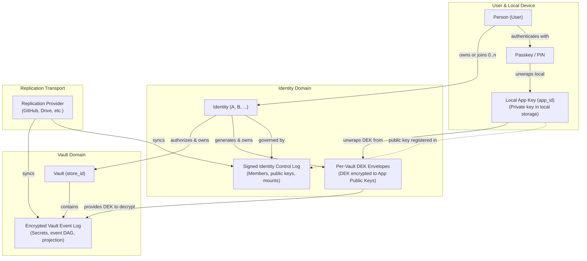

# Identity, App Keys, Passkeys, and Vault DEKs

## Overview

**Status:** Implemented.
The local identity directory, identity-owned DEKs, and the replicated
[identity control log](../../../nook-event-log/.cortex/docs/architecture/identity-control-log.md)
are implemented. Device onboarding and sync-provider mounts are identity-level.

Nook distinguishes a person, identities, passkeys, app keys, sync providers,
and vaults. None of these names are interchangeable.

## Normative vocabulary

- **Person / user**
  - **Meaning:** The human operator. One person may own or join multiple identities.
- **Identity**
  - **Meaning:** Logical authorization subject. It possesses passkeys and therefore app keys. It owns per-vault DEKs.
- **Passkey / device key**
  - **Meaning:** WebAuthn credential or PIN/passphrase fallback that protects a local app key.
- **App key**
  - **Meaning:** Installation-local asymmetric key for Simple, Sentinel, or the web extension. Replaces the former `DeviceIdentity` name.
- **`app_id`**
  - **Meaning:** Stable id for one app-key installation. Replaces the former `device_id` / `DeviceId` name.
- **Installation**
  - **Meaning:** Browser-origin or extension storage context that holds one app private key.
- **Sync-provider mount**
  - **Meaning:** Replication transport for an identity control log or vault event log. Not authority.
- **Vault**
  - **Meaning:** Encrypted secret event log addressed by `store_id`. It cannot exist without an authorizing identity.

Historical name `DeviceIdentity` means app key.
Historical name `device_id` means `app_id`.
Do not introduce those old names in new APIs.

## Domain map

## Identity domain

An identity is a logical account.
A person may keep separate identities for personal, work, family, or recovery
contexts.

An identity must have at least one passkey or PIN/passphrase protector before
it may create a vault.
That protector unwraps a local app key.
The app public key is a member of the identity.

The [identity control log](../../../nook-event-log/.cortex/docs/architecture/identity-control-log.md)
owns:

- a stable identity id;
- app-key members (`app_id`, X25519 encryption public key, Ed25519 signing
  public key, label), one-time invites, and revocations;
- per-vault DEK records: vault `store_id` plus envelopes of that vault DEK to
  each active app public key, per vault key epoch;
- zero or more credential-free sync-provider mounts.

Passkey credential records, the identity name, and vault names stay in local
storage. The log is signed, not encrypted.

Private app keys never enter the replicated identity record.
Local private app keys live in `local_identity_keyring_v1`.
Each entry binds one identity ID to one wrapped app key.
Each entry also stores an app-key-sealed event-signing seed.
The browser writes the keyring and directory in one IndexedDB transaction.
Identity-sealed sync-provider snapshots use the same app ID as their storage
scope. Switching identities cannot attempt to open another identity's provider
credentials or overwrite them.
After an Add identity protection action persists and adopts another app key,
the browser clears the prior decrypted provider grants and provider drafts.
Cancellation or failure preserves the prior session. A committed local identity
transition also clears pending extension-handoff secrets.
Protecting an identity that has no keyring entry yet adopts the signer the
session already signs with; an identity without vaults or signing evidence
mints its first signer. Existing signing evidence without its seed fails closed
instead of silently changing signer identity.
Extension import binds the grant's protected local identity before importing
event bytes or provider state. A blocked activation leaves both untouched.
An extension grant imported for another app ID becomes the persisted local
selection. Any different unlocked app-key session is cleared before import
success so extension status cannot claim a usable session for the wrong grant.

### Local directory phase

The browser stores the local directory under `identity_directory_v1`.
The directory contains:

- zero or more `IdentityRecord` values;
- an explicit `Empty` or `Selected(identity_id)` state; and
- app IDs retired by destructive local recovery.

Each app key belongs to exactly one identity; a directory that breaks this is
rejected when it is read. A valid directory remains usable without decoding a
malformed or future pending-genesis marker.

Each identity member stores its X25519 encryption public key and Ed25519 event
signing public key. A member whose signing key is unavailable cannot enter a
new signed Simple-vault genesis roster until an authenticated handoff or the
local signer supplies that public key.

Destructive device recovery retires only the explicitly targeted local app key
whose protection became inaccessible.
The target comes from the initiating tab's rendered protected-identity snapshot,
not the directory selection shared by concurrent tabs.
It removes that keyring entry and its sealed signing seed in one transaction.
It preserves unrelated local identities.
It fails before writing when the versioned keyring is malformed, unsupported,
or inconsistent with the directory.
If the directory is unreadable but the independently validated keyring remains
valid, recovery performs a safe full local-identity reset because scoped
identity ownership cannot be established.
It preserves a Simple genesis marker owned by a surviving keyring entry.
It rejects scoped recovery when a pending Sentinel finalization marker cannot
be attributed to one identity safely.
When another local identity remains, recovery removes only the retired app
key's provider snapshot.
If later provider cleanup fails, a retry resumes the app ID recorded by the
durable recovery marker. It does not reinterpret the new directory selection as
the recovery target.
Identity creation and activation remain blocked until that marker is removed,
so a stale cleanup cannot delete a replacement identity's provider credentials.
The locked recovery entry point uses the initiating manager's retained app ID
first. Only a new manager without retained scope consults persisted selection.
It does not retire paired website, extension, or peer installation identities.
A malformed retired-app ledger cannot block recovery.
Recovery replaces it with valid retirement evidence before a replacement
identity may enroll.

- **Directory concurrency:**
  - Apply every directory update in one IndexedDB read-write transaction.
  - Prevent concurrent tabs from overwriting identity creation, selection,
    membership, or DEK changes.
  - Treat persisted selection as a new-session default, not live-session
    authority.
  - Resolve an already-open manager's vault creation and identity mutations
    from its authenticated app key when another tab changes selection.
  - Carry the manager's actual private-key unlock state into combined directory
    snapshots. A retained public app ID is identity scope, not unlock proof.
  - Load each local identity's vault-access rows from only its own app-scoped
    descriptive profiles.
- **Fresh-vault extension adoption:**
  - Stage extension identity adoption through vault initialization.
  - Bind the staged identity to the live authorizer app key.
  - If no authorizer exists, bind it to the handed-off extension app key.
  - Ignore another tab's persisted selection when deriving staged ownership.
  - Keep fresh-vault membership, signing keys, and per-vault DEK envelopes only
    in the resumable genesis marker until verified connect succeeds.
  - Compare the marker's base directory with the current directory during
    completion.
  - Publish the staged directory and matching signing seed, then remove the
    marker atomically.
  - Retain unrelated concurrent identity and selection changes through a typed
    three-way rebase.
  - Abort publication when the staged identity changed concurrently or app-key
    ownership overlaps another identity.
  - Retain a rejected marker so retry resumes the same candidate.
  - After a failed create, clear decrypted host state and stop background sync
    without rolling back event stores or active identity state.
- **Existing-vault import:**
  - Use a distinct pending handoff state.
  - During verified connect, synthesize the vault owner from active signed
    envelopes and verify the extension signing key against the active event
    roster.
  - If the authorized app key already belongs to an identity, add the imported
    vault grant to that identity rather than synthesizing a duplicate owner.
  - Reject the roster snapshot if its event index names a missing event or an
    invalid event ID.
  - Reject matching event rows absent from the index. This closes the
    pre-upgrade two-transaction writer window before authorization is trusted.
  - Parse every event row and require its computed event ID to match the index
    and row key before treating it as authorization evidence.
  - Reject a graph with pending events. A known revocation awaiting a missing
    parent must not leave an older approval usable for handoff.
  - Commit the member signer and adopted signing seed atomically.
  - Return the transactionally selected DEKs and install them in the live vault
    session before clearing the pending handoff.
  - Validate a staged candidate before both unchanged-base publication and
    three-way rebase publication.
- **Legacy-vault reconciliation:** Derive DEK recipients from the signed event
  graph's active approvals after revocations, not from stale encrypted auth
  rows.

Simple vault creation uses the following marker contract:

- Store `pending_simple_genesis_v1` in IndexedDB before any event-log state.
- Record `storeId`, `identityId`, `createdAt`, `eventState`, and `flow`.
  - `flow` is explicitly `ordinary` or `staged`.
  - The staged flow carries the base directory and inactive candidate directory
    with identity-owned DEK envelopes.
- Resume the same store and identity binding after a reload.
- Block local identity creation and activation while a Simple or Sentinel
  genesis transition or local recovery cleanup remains pending.
- Remove the marker with a compare-and-delete transaction after verified
  connect completes.
  - An older tab cannot delete a newer genesis marker.
- Let the marker own the genesis timestamp and complete signed event lifecycle.
- Set `eventState` to `awaiting-event` or `event-pinned`.
  - The pinned variant owns the signed `eventYaml`, an app-key-sealed
    `signingSeedEnvelope`, and staged-member signer envelopes before the first
    event-log write.
  - Either authorized staged member can resume the exact signer and event after
    a reload.
- Decode the marker strictly: a missing field or unknown event state is an
  error, and older marker shapes are not upgraded.

Destructive recovery clears identity ownership atomically while retaining a
fail-closed ledger of retired app IDs. Tabs quiesce before recovery. Separate
auth cleanup remains retryable after a partial failure. The exclusive recovery
lock advances the storage generation on success or failure. The initiating tab
adopts that generation before it performs another queued storage operation.
Identity DEK grants
store the verified observed epoch during import. Legacy omissions require
verified reconciliation. Locked remote sync persists the verified projected
epoch before password self-enrollment can append a membership event. The v2
reconciliation marker preserves resumable progress across reloads.

The local directory caches the replicated identity control log. Identity sync
applies the log's members and DEK envelopes to the matching local record.

## DEK ownership

The identity generates each vault DEK.
The identity stores envelopes of that DEK to every current app public key.
The vault does not own a standalone DEK.
The vault cannot be created without an identity that already has:

1. at least one key; and
2. a generated DEK for that vault.

When an app key is added or removed, the identity re-wraps or drops DEK
envelopes in its control log.
The vault event log does not need an approver-written membership change.
A joined app key self-enrolls into each Simple vault log with the DEK it
already holds, and a revocation rotates each vault before its next write.

Rejected model: vault stores identity-versioned DEK blobs that rewrite on every
key add.

Legacy vault `auth:` and `members:` rows remain a wire-compatibility boundary.
Loaders synthesize an identity and move DEK envelopes onto identity-held
records.

## Vault domain

A vault owns:

- `store_id`;
- secret ciphertext under the identity-supplied DEK;
- signed vault event log and projection;
- a reference to its authorizing identity.

A vault does not own the member roster as authority.
Passwords and other secret items remain vault content.

Unlock path:

1. Passkey or PIN unwraps the local app key.
2. The app key unwraps the identity-held DEK envelope for that vault.
3. The DEK decrypts vault secrets.

## Passkey locality

WebAuthn backup eligibility remains browser-reported evidence.
A synced passkey has provider availability, not one asserted laptop location.
A synced passkey may unlock an installation's wrapped app key.
It does not copy the app private key between installations.

Target shape: fresh random locally wrapped app key per installation.
Deterministic passkey-derived app keys remain a compatibility boundary and
must not define the target model.

## Onboarding

An identity is built first. It gains app keys and sync-provider mounts, and its
vaults function on top of that infrastructure. Device onboarding and provider
mounts therefore act on the identity, never on one vault.

### Create the first vault

1. Create the identity.
2. Enroll a passkey or PIN and the local app key.
3. Generate the vault DEK and wrap it to the identity's current app keys.
4. Create the vault bound to that identity.
5. Register the vault in the identity control log with `vault-registered`.

**Prohibited:** create a vault from the hub before any identity exists, then
attach an identity later.

**Required:** create the identity and its key with the first vault. The vault
is registered in that identity's log from its genesis.

### Join an installation to an identity

1. An identity member issues a one-time invite.
   - It appends `member-invited` with a fresh invite key and a 24-hour expiry,
     and pushes it to every identity mount.
   - The enrollment code names the identity and the mount the joiner can
     reach. It also carries the invite's signing seed and every owned Simple
     vault's DEK at its current key epoch, all under the code's passphrase.
   - Issuing fails when the member cannot open an owned vault.
2. The joining installation decrypts the code inside WASM and connects that
   mount.
   - Personal credential transfer carries the provider credential.
   - A shared grant carries only the target; the joiner signs in itself.
   - The invite key and the DEKs never reach JavaScript.
3. The joiner syncs the identity log from the mount and finds the invite.
   - It refuses an invite the log does not hold yet, or one past its expiry.
4. The joiner appends a self-signed `member-joined-by-invite` and pushes it.
   - The invite key signs the joiner's member keys.
   - Each DEK from the code is wrapped to the joiner's encryption key.
   - The joiner is a member at once. No member approves it.
   - A second join with the same invite loses on every replica.
5. Its identity card lists every vault the identity owns.
6. On the first open of each Simple vault, the joiner appends a self-signed
   `join-approved` to that vault's log with the DEK it holds.
   - This uses the existing Simple self-enrolment policy in
     [vault-event-log.md](../../../nook-event-log/.cortex/docs/architecture/vault-event-log.md).
   - No member writes into any vault log.

A vault registered after the invite went out reaches the joiner through
`vault-dek-granted`, like any member that joined concurrently with a
registration.

**Prohibited:** make the member who issued the invite approve the joiner as
well. The passphrase-protected code already proves the joiner holds the
invite, so a second confirmation adds a round trip and no security.

**Required:** let the invite holder sign itself in, once, with the DEKs the
code carries. The joiner reaches each vault through the identity.

Logs from earlier builds may hold `member-join-requested`, `member-approved`,
and `member-join-denied`. They still project, so members admitted by approval
stay members. Nothing writes them now, and a pending request from an earlier
build is not offered for approval; that installation joins with a new invite.

### Revoke an installation

1. A member appends `member-revoked` for the app key.
   - The identity always keeps at least one member.
2. The open vault rotates immediately.
   - Its log records `device-revoked` and an epoch checkpoint.
   - The identity log records `vault-dek-granted` for the new epoch.
3. Every other owned vault rotates before its next write.
   - Opening a vault compares its signed roster with identity membership.
   - A vault actor revoked from the identity is revoked from the vault first.
   - The rotation and its identity rewrap complete before any edit.

Revocation never protects data the revoked installation already decrypted. It
stops that installation from reading anything written afterwards.

**Prohibited:** revoke an app key in the identity log and let another vault
accept new secrets under its old key epoch.

**Required:** rotate that vault before its next write. The revoked app key
holds no envelope for the new epoch, so it cannot read later secrets.

### Keep Sentinel vaults on their ceremony

Sentinel vault keys are threshold shares, not a DEK the identity can wrap.
An identity invite grants a joiner the identity's Simple vaults only. A Sentinel
vault keeps its participant ceremony in
[sentinel-genesis.md](sentinel-genesis.md).

**Prohibited:** wrap a reconstructed Sentinel key bundle to a joiner during
an identity invite join.

**Required:** list the Sentinel vault on the joiner's identity card as needing
its ceremony. Identity membership never bypasses the threshold.

### Issue identity enrollment codes

The enrollment code invites an installation into an identity, not a vault.

- The encrypted payload holds the provider transport,
  `identity: { identity_id, label }`, and
  `invite: { invite_id, signing_seed, vaults: [{ store_id, key_epoch,
  secrets_key, members_key }] }`.
- The provider transport keeps the personal and shared typestates described in
  [auth-providers.md](auth-providers.md#shared-provider-onboarding).
- The outer envelope and its PBKDF2 and AES-GCM parameters are unchanged.
- Only WASM issues and opens codes. JavaScript passes the code and passphrase
  through and receives the label and provider, never the invite.
- Codes issued by earlier builds carry no invite. They are short-lived
  invitations and fail closed as invalid codes; the member issues a new code.

**Prohibited:** keep `vault_name` in the payload so the joiner's identity card
can show the vault before it joins.

**Required:** name only the identity. The joiner learns the identity's vaults
from the control log; the code carries only their DEKs.

### Mount sync providers on the identity

Provider rows stay in the app-scoped `providers:{app_id}` snapshot, which is
already one local identity's storage.

- **Remote rows (GitHub, Google Drive, iCloud, local folder)**
  - Are identity mounts: each replicates the identity log and every vault the
    identity owns.
  - Use the namespaced paths in
    [identity-control-log.md](../../../nook-event-log/.cortex/docs/architecture/identity-control-log.md#store-the-log-once-per-provider-mount).
- **Browser rows**
  - Hold one vault in this browser's own store.
- **Mount records**
  - The identity log records each remote row's credential-free target.
  - A joining installation sees recorded mounts it has not connected and
    connects each with its own credential.

**Prohibited:** add a GitHub provider while vault A is open and leave vault B
of the same identity without replication.

**Required:** add the provider on **Identity → Sync**. The row replicates the
identity log and both vaults.

## Browser extension boundary

The extension is another installation with its own `app_id` and app key.
It is not itself an identity.
It acts through a selected identity after the matching app key is enrolled.

## Invariants

- A vault cannot exist without at least one authorizing identity.
- A vault cannot hold a DEK by itself.
- Identity owns per-vault DEKs and member envelopes.
- Passkey protects app key; app key is a member of identity.
- `app_id` names an installation app key, not a person and not a vault.
- No provider credential grants identity membership or vault decryption.
- Portable identity, app-key, DEK, and vault policy belongs in Rust.
  Svelte renders typed state and coordinates browser ceremonies.

## Related records

- [devices-and-access.md](../../../../.cortex/docs/spec/devices-and-access.md)
- [auth-providers.md](auth-providers.md)
- [vault-event-log.md](../../../nook-event-log/.cortex/docs/architecture/vault-event-log.md)
- [identity-control-log.md](../../../nook-event-log/.cortex/docs/architecture/identity-control-log.md)
- [vault-session-and-lock.md](vault-session-and-lock.md)
- [browser-extension.md](../../../../nook-web/nook-web-extension/.cortex/docs/spec/browser-extension.md)
